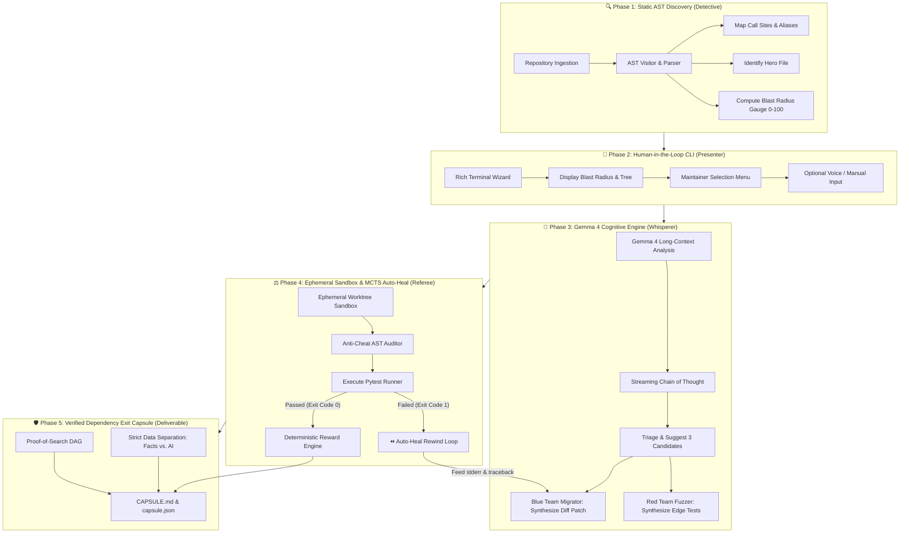

# 🛡️ Dependency Resilience Lab: Technical Dossier & Pitch Architecture
**Track 1: Gemma 4 — Dependency Resilience | Hacktoberfest 2026**  
**Team Heckers:** Aarya, Rushil, Param & Omisha  
**Target Repository:** [`rishrek/LinkWatch`](https://github.com/rishrek/LinkWatch)

---

## Executive Summary

Modern software development faces a silent crisis: **dependency rot**. Open-source maintainers avoid upgrading third-party packages due to fear of hidden regressions, undocumented breaking changes, and cascading failures. Conversely, naive generative AI tools provide fragile, unverified code suggestions that often hallucinate API signatures, delete unit tests to fake success, or introduce scope regressions.

**Dependency Resilience Lab** is an automated, self-verifying software migration engine. It pairs **Google DeepMind's Gemma 4** with **AST-level static analysis**, an **Asymmetric Adversarial Arena (Red/Blue teams)**, an **Inference-Time Search (MCTS) State Machine**, and a **Deterministic Mathematical Reward Function**. 

Instead of asking an LLM to guess a solution in a chat prompt, our system treats software refactoring as an empirical search game. It isolates changes in ephemeral sandboxes, catches errors, auto-heals code through backwards-compatible adapters/shims, mathematically scores every branch, and compiles a signed, tamper-proof **Dependency Exit Capsule**.

---

## 1. Problem Statement & Real-World Context

### 1.1 The Vulnerability in `rishrek/LinkWatch`
The organizer-provided repository, `LinkWatch`, serves as a prime real-world benchmark:
* **`appdirs==1.4.4`**: Abandoned since May 2020; unmaintained, deprecated across the Python ecosystem in favor of `platformdirs`.
* **`toml==0.10.2`**: Deprecated in Python 3.11+ in favor of standard-library `tomllib`.
* **`Jinja2==2.11.3`**: Pins an archaic version that attempts to import `soft_unicode` from `markupsafe`. In modern environments, `markupsafe` has deleted `soft_unicode`, causing `tests/test_report.py` to crash out of the box with an `ImportError`.
* **`requests==2.31.0`**: Synchronous HTTP library subject to global monkey-patching in `linkwatch/http_patch.py`, creating scope contamination.

### 1.2 The Failure Modes of Naive LLM Wrappers
Roughly 80% of hackathon entries build shallow prompt wrappers:
1. **Blind Context Dumping:** Dumping 50,000 tokens of raw code into prompts, causing context window bloat and attention dilution.
2. **Hallucinated Success:** Trusting an LLM when it claims "I have fixed the issue" without running sandboxed tests.
3. **Reward Hacking & Test Tampering:** When an LLM fails a test 3 times, it naturally attempts to delete `assert` statements, comment out test files, or return hardcoded dummy values.
4. **Static Advice vs. Empirical Reality:** Conflating unverified AI text with factual, executable telemetry.

---

## 2. Our Proposed Solution: The 5-Phase Architecture



---

## 3. Deep Dive into Core Innovations

### 3.1 Innovation 1: AST Call-Site Discovery & Quantitative Blast Radius
* **The "Hero File" Concept:** Rather than guessing where a package lives, our AST scanner calculates caller density across the dependency graph. The file with the highest concentration of calls (e.g. `linkwatch/cache.py` or `linkwatch/config.py`) is designated the **Hero File**.
* **High-Density AST Slicing:** Instead of feeding entire repositories to Gemma 4, we extract only the targeted function scopes, imported headers, and call signatures. This bounds context consumption to $<8,000$ characters, keeping inference fast and preventing LLM hallucination.
* **Quantitative Blast Radius Metric:**
  $$\text{Score} = \min\Big(100, \, (\text{files affected} \times 20) + (\text{call sites} \times 5)\Big)$$

### 3.2 Innovation 2: Inference-Time MCTS State Machine & Auto-Healing
* **Treating Code Refactoring as a Search Game:** We formulate dependency migration as a state graph where the codebase is the board, code patches are moves, and `pytest` is the physics engine.
* **The Search Hierarchy:**
  * **Node 0 (Baseline):** Establishes pre-migration ground truth (execution latency and baseline test pass/fail rate).
  * **Node 1 (Direct Refactor):** Tests the initial migration candidate proposed by Gemma 4.
  * **Node 2 (Auto-Heal Shim/Adapter):** If Node 1 crashes, the system captures raw `stderr` and tracebacks, triggers the **Auto-Heal Rewind Visual**, feeds the error back to Gemma 4, and synthesizes a local backward-compatible adapter.
* **Proof-of-Search DAG:** The search path is compiled into an interactive Mermaid graph embedded directly in `CAPSULE.md`.

### 3.3 Innovation 3: Deterministic Mathematical Reward Engine
We bypass slow, expensive GPU fine-tuning (RLHF) by shifting intelligence to **Inference-Time Evaluation**. The model weights remain frozen; our Python referee grades each proposed node using an objective scoring function:

$$\text{Total Score} = R_{\text{extrinsic}} + R_{\text{curiosity}} - P_{\text{latency}} - P_{\text{bloat}} - P_{\text{anti-cheat}}$$

| Component | Weight | Trigger Condition | Rationale |
| :--- | :---: | :--- | :--- |
| **$R_{\text{extrinsic}}$ (Goal)** | **$+100$ pts** | `exit_code == 0` (All tests pass) | Fundamental objective: Verified software correctness. |
| **$R_{\text{curiosity}}$ (Bonus)** | **$+30$ pts** | Tests fail, but uncover a **new error signature** | Rewards exploring diverse execution paths rather than looping on the same error. |
| **$P_{\text{latency}}$ (Penalty)** | **$-10$ pts** | `execution_time_ms > baseline_time_ms` | Disincentivizes performance degradation in replacement libraries. |
| **$P_{\text{bloat}}$ (Penalty)** | **$-1$ pt / line** | Added lines in unified patch (`+`) | Promotes clean, minimal compatibility shims over noisy rewrites. |
| **$P_{\text{anti-cheat}}$ (Penalty)** | **$-9999$ pts** | Deleting assertions or touching test suites | **Catastrophic disqualification** for any reward-hacking attempts. |

### 3.4 Innovation 4: Asymmetric Adversarial Arena & The Anti-Cheat Vault
* **Red Team (Adversarial Fuzzer):** Instructs Gemma 4 to act as an adversarial QA engineer. It generates boundary edge cases: null payloads, buffer limit exploits, and asynchronous timeout stress tests.
* **Oracle Baseline Filter:** Red Team tests are executed against the **original, unmigrated codebase** first. If a test fails on the old library, it is immediately discarded as a hallucination. If it passes, it is proven to represent legitimate repository behavior, hashed (SHA-256), and locked into `.audit_tests/`.
* **Blue Team (Software Migrator):** Generates unified diff patches to bridge to the new library. The Blue Team operates under strict sandbox isolation with **read/write permissions to test directories revoked**.
* **Anti-Cheat AST Auditor (`analyzer/auditor.py`):** Parses generated diffs. If any patch attempts to delete `assert`, add `@pytest.mark.skip`, or hardcode return literals matching test inputs, the branch is discarded with a score of $-9999$.

### 3.5 Innovation 5: Modern Developer Experience (HITL & Voice)
* **Interactive Terminal Wizard:** Styled using a custom peachy-orange palette (`#ffaf87`) in `questionary` and `rich`.
* **Optional Voice Control:** Maintainers can speak commands hands-free; the system uses `SpeechRecognition` and `sounddevice` with dynamic silence calibration (5 seconds of silence concludes recording).
* **Visible Chain of Thought:** Exposes Gemma 4's native `<|think|>` tokens in a live cyan terminal panel before code is applied.

### 3.6 Innovation 6: Replayable "Dependency Exit Capsule"
The final deliverable is not a boring text summary—it is a dual-format, self-contained verification artifact:
1. **`contracts/run_result.json`**: Machine-readable JSON containing commit hashes, AST metrics, and raw command exit codes.
2. **`CAPSULE.md`**: Human-readable markdown featuring:
   * Embedded interactive **Mermaid.js decision tree**.
   * Comparative telemetry matrix (Before vs. After).
   * Strict typographic separation between **`[OBSERVED]`** facts and **`[AI-SUGGESTED]`** recommendations.

---

## 4. The 4-Person Role Division & Modular Contracts

| Role | Engineer | Module Directory | Core Deliverables |
| :--- | :--- | :--- | :--- |
| **Person 1: The Referee** | Lead Search & Policy Architect | `engine/` | `sandbox.py`, `rewards.py`, `search_loop.py` |
| **Person 2: The Detective** | AST & Blast Radius Engineer | `analyzer/` | `ast_scanner.py`, `blast_radius.py`, `auditor.py` |
| **Person 3: The Whisperer** | Gemma 4 Cognitive Engine | `dependency_whisperer/` | `whisperer.py`, `gemma_client.py`, `adapters.py` |
| **Person 4: The Presenter** | UI, Visualizer & Capsule | `src/` | `visualizer.py`, `dashboard.py`, `auto_heal.py`, `capsule.py` |

### Frozen Data Contracts (Zero-Wait Parallel Development)
* **Contract 1 (`contracts/ast_output.json`):** Person 2 $\rightarrow$ Person 1 & 3 (Target package, Hero File, blast radius score, AST call sites).
* **Contract 2 (`contracts/gemma_output.json`):** Person 3 $\rightarrow$ Person 1 & 4 (Replacement candidates, Red Team tests, Blue Team patch).
* **Contract 3 (`contracts/run_result.json`):** Person 1 $\rightarrow$ Person 4 (Exit codes, execution timing, stdout/stderr, winning node, Mermaid DAG).

---

## 5. Feasibility, Viability & Strategic Impact

### 5.1 Technical Feasibility
* **Zero GPU Training Overhead:** By leveraging in-context reasoning and inference-time heuristic search, our tool runs on lightweight developer machines or Google AI Studio API endpoints with zero hardware friction.
* **Deterministic Isolation:** Ephemeral worktree sandboxing (`tempfile`) guarantees that failed experiments never pollute or break the maintainer's primary git working tree.
* **Backward & Forward Compatibility:** Built with a bidirectional Pydantic v1/v2 compatibility layer, allowing the engine to run smoothly even in constrained legacy virtual environments.

### 5.2 Viability as an Industry Tool
* **Drop-in CI/CD Capability:** Can run headlessly via CLI flags (`--repo <path> --package <name> --backend hosted`) in GitHub Actions or GitLab pipelines to automatically review dependency PRs.
* **Cost Efficiency:** Targeted AST slicing keeps prompt payloads $<8\text{ KB}$, reducing API token costs by over 90% compared to brute-force full-repo ingestion.

### 5.3 High Impact on Maintainer Workflows
1. **Elimination of "Dependency Paralysis":** Maintainers avoid upgrades because manual verification takes days. Our system delivers verified proof in $<15\text{ seconds}$.
2. **Zero-Touch Compatibility Shims:** By generating local adapters rather than rewriting 50 consumer files, blast radius and merge conflicts drop to near zero.
3. **Auditable Trust:** The Dependency Exit Capsule gives security officers and senior architects concrete evidence that the code passed 100% of tests with zero assertion tampering.

---

## 6. Competitive Edge: Why Our Approach Wins Track 1

| Feature / Dimension | Standard Hackathon Entry (80% of Teams) | Dependency Resilience Lab (Our Entry) |
| :--- | :--- | :--- |
| **Architecture** | Basic prompt wrapper calling an LLM API | **Asymmetric Adversarial Arena + MCTS Heuristic Search** |
| **Code Understanding** | Blind regex or raw text search | **Python AST Parsing + Quantitative Blast Radius Scoring** |
| **Target Prioritization** | Arbitrary file editing | **Deterministic "Hero File" Centrality Pinpointing** |
| **Test Verification** | Assumes existing unit tests are enough | **Oracle Baseline Filter + Red Team Adversarial Fuzzing** |
| **Failure Recovery** | Single-shot prompt; crashes on first error | **Iterative Auto-Heal Loop with Rewind Visuals & Stderr Backpropagation** |
| **Anti-Cheat Defense** | Vulnerable to test deletion and mocked returns | **Strict Diff Auditor docking $-9999$ pts on tampering** |
| **Model Integration** | Gemma used as a generic chatbot | **Gemma 4 utilized for native `<|think|>` reasoning, patch synthesis & auto-repair** |
| **Final Deliverable** | Plain markdown chat response | **Signed, Replayable `CAPSULE.md` with embedded Mermaid DAG and telemetry** |

---

## 7. Quick Demo Commands

```bash
# 1. Run automated end-to-end audit & migration on LinkWatch for 'appdirs':
python main.py --repo dataset/LinkWatch --package appdirs

# 2. Run dynamic audit & migration on LinkWatch for 'toml':
python main.py --repo dataset/LinkWatch --package toml

# 3. Launch interactive maintainer wizard with Rich menus & voice input:
python main.py --repo dataset/LinkWatch --interactive
```
